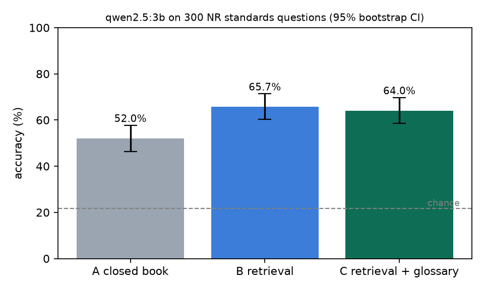

# speaks-3gpp

[](https://github.com/rakeshreddy3466/speaks-3gpp/actions/workflows/ci.yml)

**Does the model speak 3GPP? Grounding a local LLM in 5G NR standards.**

A small local model (`qwen2.5:3b` on Ollama) answers 300 5G NR standards questions from the public
[TeleQnA](https://github.com/netop-team/TeleQnA) benchmark in three setups that differ only in the
prompt context: **A** closed book, **B** retrieval over nine Release 17 NR specifications split by
clause, and **C** retrieval plus an acronym glossary built from the 3GPP vocabulary (TR 21.905)
and each spec's abbreviation clause. The question list was frozen and committed before any model
call.

**Headline.** Retrieval lifts accuracy from **52.0% to 65.7%** (+13.7 points, 69 questions fixed
and 28 broken, exact McNemar p = 3.8e-05). The acronym glossary does **not** help on top of that
(64.0%, -1.7 points, p = 0.46): it changed one of the four retrieved excerpts on average and the
model already reads acronyms well when the right text is in front of it. The bottleneck is search,
not reading: the answer text was in the top 4 excerpts for only 53% of questions; when it was, the
model was right 74% of the time, when it was not, 56%, about the same as closed book.



## Results

| | A closed book | B retrieval | C retrieval + glossary |
|---|---|---|---|
| Accuracy (95% bootstrap CI) | 52.0% (46.3 to 57.7) | **65.7%** (60.3 to 71.3) | 64.0% (58.7 to 69.7) |
| Correct | 156/300 | 197/300 | 192/300 |
| Wrong to right / right to wrong vs A | | 69 / 28 | 66 / 30 |
| Answer text in the top 4 excerpts | | 53% | 51% |
| Accuracy when it was / was not | | 74.2% / 56.0% | 75.8% / 51.7% |
| Wrong: missing context / context present | | 62 / 41 | 71 / 37 |
| Median prompt tokens, seconds per question | 125, 0.27 s | 1,290, 4.8 s | 1,315, 5.4 s |

Chance is 21.7% (four or five options). Every reply parsed (0 unparsed of 900). C vs B: 12 questions
only C got right, 17 only B, so the glossary effect is indistinguishable from zero here. In 11 of
the 28 questions that retrieval broke, the answer text was in the excerpts and the model still
moved away from it; in the other 17 the answer text was not in the excerpts and they pulled it away.

Tables: [T1 accuracy](results/tables/T1_accuracy.md) |
[T2 paired McNemar](results/tables/T2_paired_mcnemar.md) |
[T3 error groups](results/tables/T3_error_groups.md) |
[T4 flips](results/tables/T4_flips_vs_closed_book.md) |
[T5 glossary diagnostics](results/tables/T5_glossary_diagnostics.md).
Figures: [F1 accuracy](figures/F1_accuracy.png) | [F2 error groups](figures/F2_error_groups.png) |
[F3 flips](figures/F3_flips.png). Full write-up: **[REPORT.md](REPORT.md)**.

## Data

- **Questions:** TeleQnA (MIT licence, [arXiv 2310.15051](https://arxiv.org/abs/2310.15051)),
  categories "Standards specifications" and "Standards overview", tagged `[3GPP Release 17]`, with a
  RAN keyword in the question (fixed list in `configs/experiment.yaml`). 336 matched; a seeded
  sample of 300 (269 specifications, 31 overview) was frozen in
  [`results/question_ids.json`](results/question_ids.json). TeleQnA is password protected by its
  authors to avoid training contamination, so it is downloaded at run time and **no question text
  is committed**, only ids and aggregates.
- **Corpus:** latest Release 17 versions of TS 38.300, 38.331, 38.321, 38.211, 38.213, 38.214,
  38.304, 38.401 and 37.340 (exact versions in [`results/spec_versions.json`](results/spec_versions.json)),
  parsed from the Word files by heading style into 5,164 chunks of about 220 words. Every chunk
  keeps its spec and clause number (`TS 38.331 §5.3.5 #0`), so each answer can point to its source.
- **Glossary:** 390 acronyms from the abbreviation clauses of the nine specs and TR 21.905;
  spec-local meanings first (for example `SSB: SS/PBCH block / Synchronization Signal Block`).

## Reproduce

```
uv sync                       # Python 3.12; tests and reports need no model
make test && make lint
make report                   # every table and figure from the committed results/summary.json
```

From scratch (needs [Ollama](https://ollama.com) with `qwen2.5:3b`, about one hour):

```
uv sync --group retrieval     # adds sentence-transformers (PyTorch)
make data                     # Release 17 specs from the 3GPP archive, TeleQnA from GitHub
make questions                # freezes results/question_ids.json; commit it before any model call
make index                    # clause chunks, glossary, all-MiniLM-L6-v2 embeddings
make pilot && make run        # 900 answers, resumable (runs/ is git ignored)
make analyse && make report
make review                   # sheet of 50 wrong answers to label by hand, then make review-summary
```

**Hardware notes.** Run on a MacBook Pro (Apple silicon, 8 GB). Closed book takes about 0.3 s per
question and retrieval about 5 s, almost all of it reading the 1,300 token prompt; the full run
took 58 minutes of model time. Every request sends `num_ctx=8192`, temperature 0 and a fixed seed.
Search is exact cosine similarity over a NumPy matrix (5,164 x 384), which at this size needs no
vector database.

## Limitations (brief)

One small model and one embedding model; 300 questions, so a difference of a few points (like
B vs C) cannot be told apart from noise; TeleQnA questions are machine generated and some have more than one defensible
option; the context hit test is a word overlap heuristic; only nine specs, so some questions point
to text outside the corpus; top 4 excerpts and one chunk size were fixed in advance, not tuned.
Details in [REPORT.md](REPORT.md).
